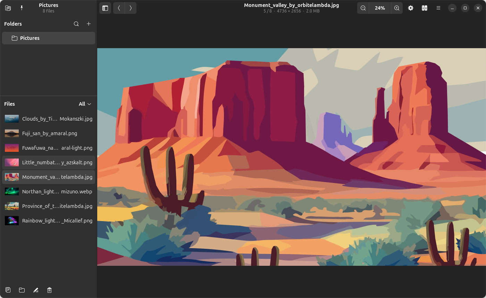
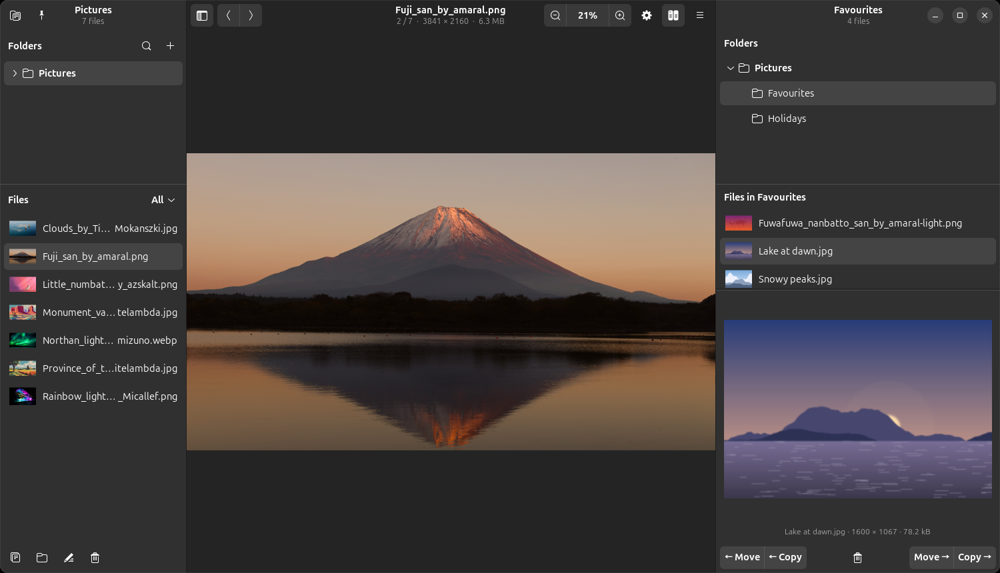

# Glimpse Media Viewer

Glimpse Media Viewer is a fast, simple viewer and organiser for your photos, videos and music, made to fit right into GNOME. Open any file and everything in its folder is ready to browse in the sidebar, with thumbnails, tags and cover art.



## Features

### View
- Thumbnails of every image and video, and cover art for songs
- Zoom with buttons, the keyboard, Ctrl+scroll or a pinch, and drag to pan
- JPEG, PNG, WebP, HEIC, AVIF, TIFF, SVG, GIF and many other image formats
- Fullscreen viewing: press F11, or double-click a video

### Play
- Videos play right in the window: MP4, MOV, MKV, WebM, AVI, WMV and more, with H.264, HEVC, VP9 and other common codecs
- Music shows its title, artist, album and cover art: MP3, FLAC, Ogg, Opus, AAC, Apple Lossless, WAV, AIFF, WMA and WavPack
- A folder of songs plays straight through, like an album

### Search
- Search every pinned folder and its subfolders at once, even large libraries on external drives
- Find files by part of their name, by type (images, videos, music or a single format such as PNG or MP3), and by date taken or date modified
- Tick tags to find images with any of them, or only those with all of them
- Combine all of these in one search, and see how many files match as you go

### Organise
- Pin your favourite folders to the sidebar, and drag files onto them to move or copy, with undo and Alt+1…9 quick-move keys
- Copy, move, rename and delete several files at once, to the trash or permanently
- Set any image as your wallpaper

### Tag
- Add, rename and remove tags on one image or many at once
- Tags are saved inside the image as standard XMP and IPTC keywords, so other photo apps such as darktable, digiKam and Shotwell can read them too
- Show only the images with a tag, or sort them by tag

### Split screen
- Show a second folder beside the first with F3, chosen in its own folder tree, so each side stays on its own folder
- Drag files between the two folders to move them, or hold Ctrl to copy; F6 moves and F5 copies the selection
- See a preview of the file selected in the second folder
- Move and Copy buttons send files either way, and a Delete button removes the files selected in the second folder
- After each move the next file is selected, ready for the next one, and Undo puts things back



### More
- Properties shows file and camera details: camera, lens, exposure and date taken
- Open files in another app, or show them in Files
- Built-in help for every feature, and a list of every keyboard shortcut

## Install

Glimpse is packaged as a snap, `glimpse-media-viewer`. The Snap Store release is waiting for review; once it's published:

```sh
sudo snap install glimpse-media-viewer
```

To use files on external drives, connect the removable-media interface:

```sh
snap connect glimpse-media-viewer:removable-media
```

### Run from source

On Ubuntu or Debian, install the dependencies and run the script:

```sh
sudo apt install python3-gi gir1.2-gtk-4.0 gir1.2-adw-1 gir1.2-gexiv2-0.10 \
    gir1.2-gst-plugins-base-1.0 libgtk-4-media-gstreamer \
    gstreamer1.0-plugins-good gstreamer1.0-plugins-bad gstreamer1.0-plugins-ugly gstreamer1.0-libav
python3 glimpse-media-viewer/glimpse.py
```

To add it to Activities and run it as `glimpse`, run `glimpse-media-viewer/install.sh` as your own user (no root needed).

GExiv2 is optional (without it Properties shows file details only), and GStreamer is needed only for video and music.

## Help

Press F1 in the app for the full guide, or Ctrl+? for keyboard shortcuts. Report bugs and ideas in [Issues](https://github.com/pst007xx/glimpse-media-viewer/issues); for security problems, see [SECURITY.md](SECURITY.md).

## License

Glimpse Media Viewer is free software under the [GNU General Public License v3.0 or later](LICENSE).
© 2026 Salvatore Turone
